<p align="center">
  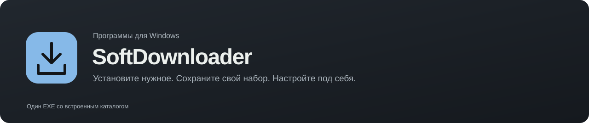
</p>

<p align="center">
  <a href="https://github.com/HVHBIGNAME/SoftDownloader/releases/latest"></a>
  <a href="https://github.com/HVHBIGNAME/SoftDownloader/actions/workflows/windows.yml"></a>
  
  <a href="LICENSE"></a>
</p>

**Нативный менеджер программ для Windows на Rust + egui — один EXE.** Отметьте нужный софт или выберите готовый набор, задайте режим и нажмите **Установить**. Приложение добавит зависимости, пропустит установленное и выполнит очередь. Свои наборы помогут повторить настройку на другом ПК.

<p align="center">
  <a href="https://github.com/HVHBIGNAME/SoftDownloader/releases/latest/download/SoftDownloader.exe"><b>Скачать SoftDownloader.exe</b></a> ·
  <a href="#перенос-списка-программ">Перенос программ</a> ·
  <a href="#видео-использования">Видео</a> ·
  <a href="docs/verification.md">Проверки</a>
</p>

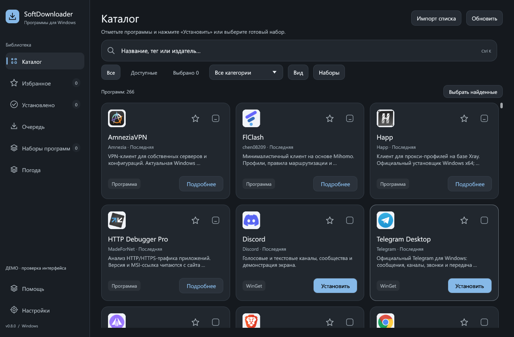

**В 0.8.0:** более крупные кнопки и читаемые подписи, адаптивные подробности и панель установки, иконки для всех 266 карточек, понятные результаты очереди, оптимизированный поиск и плавное погодное небо. [Описание выпуска](docs/releases/0.8.0.md) · [Визуальный аудит](docs/ui-design.md) · [Иконки](docs/icons.md) · [Проверки](docs/verification.md).

## Начать работу

1. Скачайте **[SoftDownloader.exe](https://github.com/HVHBIGNAME/SoftDownloader/releases/latest/download/SoftDownloader.exe)** и запустите его.
2. Дождитесь проверки установленного ПО. Отметьте программы в каталоге или откройте **Наборы программ**.
3. Выберите **Тихая установка** или **С мастером** и нажмите **Установить**. Очередь запускается сразу; результат каждой программы виден отдельно.

Кнопка **План** показывает зависимости до запуска. Обязательное подтверждение можно включить в **Настройки → Установка**.

Для пакетов WinGet нужен [Установщик приложений Microsoft](https://apps.microsoft.com/detail/9nblggh4nns1). EXE/MSI при необходимости откроют штатный мастер или запрос UAC.

Само приложение поставляется одним файлом, работает с системными библиотеками Windows и хранит настройки/кэш в AppData. Установка Rust, Python или отдельного runtime для его запуска не требуется. Файл `.sha256` в релизе — необязательная проверка скачивания; видео и документация доступны отдельно.

**Автообновление с 0.5.2:** приложение само проверяет GitHub Releases, скачивает новую стабильную версию, проверяет SHA-256, заменяет EXE и перезапускается после завершения текущих операций. Настройки и выбор сохраняются; при неудачном запуске возвращается прежний EXE. Управление — **Настройки → Обновления**. Для перехода с 0.5.1 и старше скачайте новый файл один раз. **[Как работает обновление](docs/updates.md)**.

## Установка и наборы

- **Одна кнопка:** запуск всего выбора, готового набора или отдельной программы через **↓** в строке, кнопку в карточке или подробностях.
- **Два режима:** тихие параметры либо штатный мастер. У отдельной программы можно задать исключение; настройки уже запущенной очереди не меняются.
- **Десять готовых наборов:** базовый ПК, работа и учёба, удобная Windows, документы и сканы, учёба и исследования, диагностика Windows, разработка, веб-разработка, игры и общение, творчество. Состав раскрывается перед установкой.
- **Мои наборы:** сохраните выбор или избранное под своим именем, обновите состав, экспортируйте JSON. Удаление набора можно отменить кнопкой **Вернуть**.
- **Понятная очередь:** общий прогресс, режим каждой задачи, пауза после текущей, отмена следующих, повтор незавершённых — в том числе с мастером — и открытие логов.
- **Независимые задачи продолжаются:** недоступная программа не блокирует весь набор; её причина видна отдельно. Неустановленная зависимость блокирует только зависимые программы.

**[Подробности режимов и очереди](docs/installation.md)** · **[Свои наборы и перенос](docs/program-lists.md)**

## Каталог под себя

- **Список или карточки** — переключаются в меню **Вид**. Выбор, статус установки и избранное занимают одинаковые фиксированные места.
- **Мягкое оформление** — единые скругления, фильтры-капсулы, счётчики в навигации и отдельная панель установки. Выбранные карточки выделяются рамкой и фоном, поиск — рамкой при фокусе.
- **Избранное** — звёздочка рядом с программой сохраняет её в вашей коллекции, включая уже установленное ПО.
- **Все / Доступные / Выбрано** — быстрые фильтры. Поиск **Ctrl+K / Ctrl+F**, группы и сортировка по имени помогают сузить список.
- **Выбрано** показывает весь выбор. Его можно сохранить как набор или JSON; случайную очистку отменяют **Вернуть** или **Ctrl+Z**. Выбор сохраняется при обычном закрытии приложения.

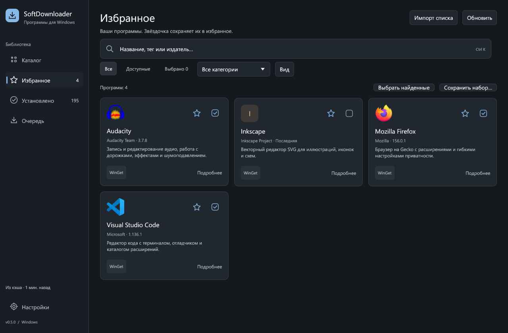

## Темы, звуки и видеофон

Настройки разделены на **Оформление**, **Звуки**, **Видеофон**, **Источники и данные**, **Обновления** и **Установка**.

| Настройка | Что доступно |
|---|---|
| **Четыре темы** | Тёмная, светлая, серая и ночная. Пять готовых акцентов и свой цвет; контраст текста сохраняется при переключении. |
| **Новые звуки** | Пять оригинальных стереонаборов 44,1 кГц: Аврора, Кино, Кристалл, Тактильные, Орбита. Разные сигналы нажатия, завершения и ошибки; нажатия можно отключить отдельно. |
| **Праздники** | Многослойный снег с мягкими частицами и ветром; фотореалистичная тыква в лесу с туманом и свечением. Режимы по календарю или вручную. |
| **Настоящее видео** | Свой MP4 либо 11 готовых сцен на всё окно. Приглушение, пауза, плавная смена роликов и воспроизведение без звука. |
| **Погода по городу** | Поиск с вариантами городов, определение по IP по кнопке, данные MET Norway каждые 15 минут. Дождь, ливень, снег, метель, туман, облака, ясная погода и гроза; отдельный град в демо. |

Погодный режим включается в **Погода** в боковой панели. Выберите город: облака, осадки и небо анимируются в реальном времени, дополнительное видео можно включить отдельно. Освещение **Авто / Рассвет / День / Вечер / Закат / Ночь** использует солнце в выбранном городе или ручной предпросмотр. Режим **ДЕМО** показывает выбранный эффект независимо от погоды. При выключении погоды возвращается прежний фон. Видимое окно продолжает анимацию без фокуса; сворачивание, пауза и **Уменьшить анимацию** останавливают движение.

**[Как настроить погоду и город](docs/weather.md)**

| Погода в фоне приложения | Новая сцена Хэллоуина |
|---|---|
| 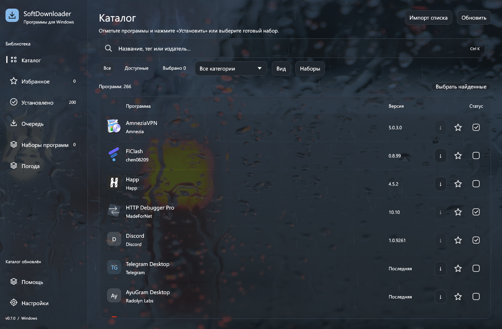 |  |

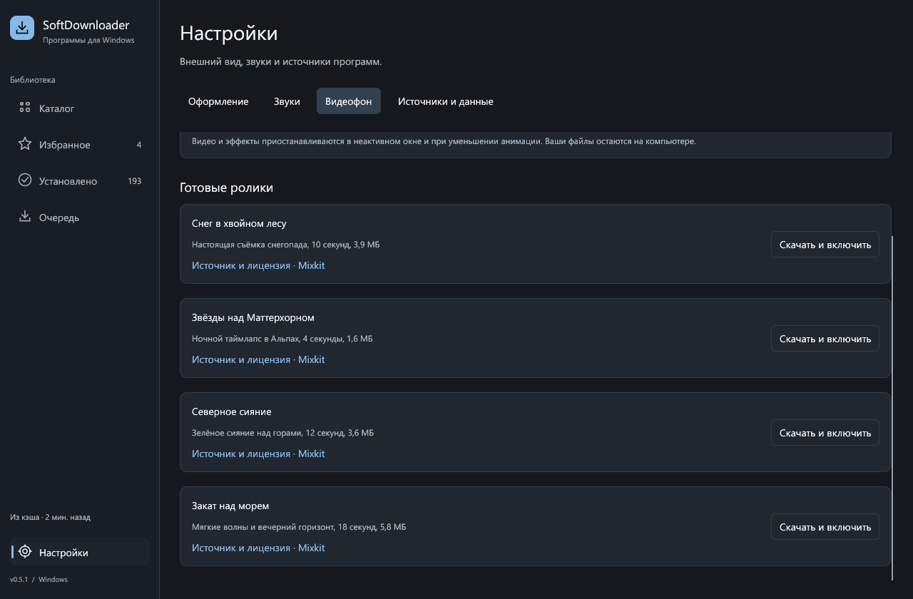

| Светлая тема | Видеофон с предпросмотром |
|---|---|
| 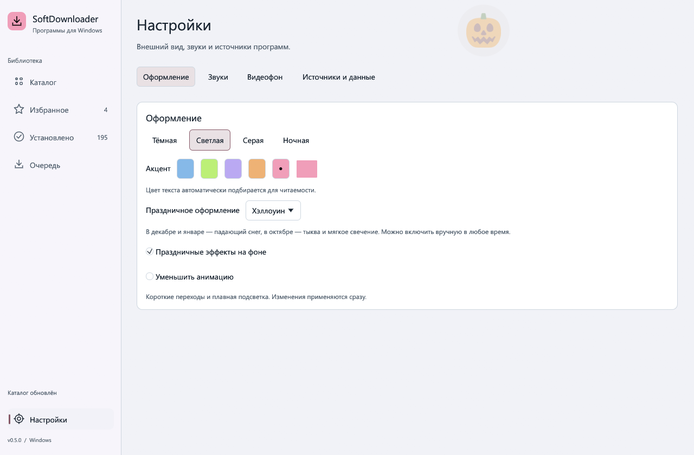 | 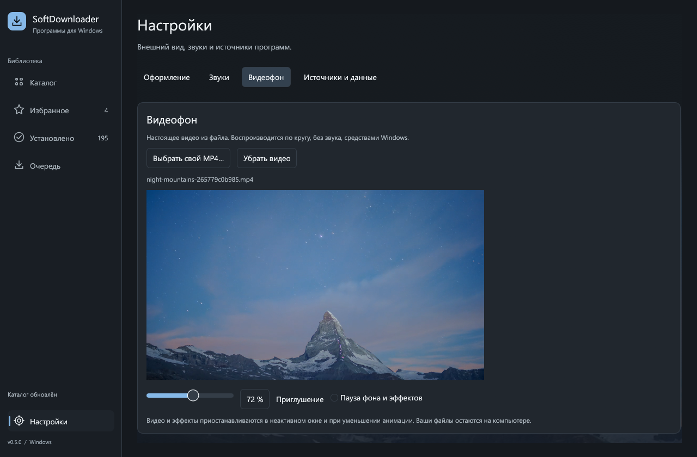 |

**[Настройка оформления и звуков](docs/appearance.md)** · **[Источники материалов и лицензии](assets/CREDITS.md)**

## Первый запуск и обновления

При первом запуске открывается короткий гайд из пяти шагов. **Начать работу** или **Пропустить** сохраняет прохождение в локальном `settings.json`; повторно он сам не открывается. Кнопка **Помощь** позволяет вернуться к нему.

После смены версии показывается небольшая таблица **Что нового**. Она появляется один раз для каждой версии после подтверждения **Понятно**. Открыть её снова можно в **Настройки → Обновления**.

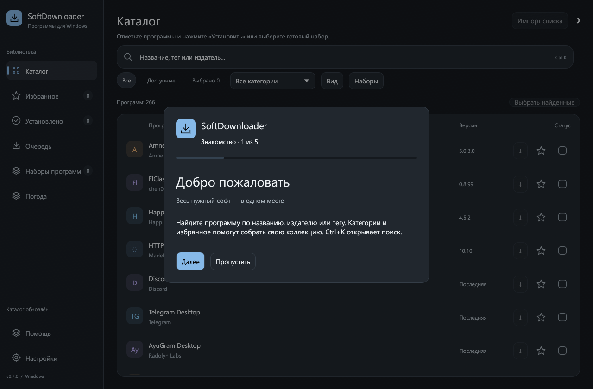

## Перенос списка программ

**На текущем ПК:** `Установлено → Экспорт списка` → сохраните JSON-файл.

**На новом ПК:** `Импорт списка` или **Ctrl+O** → выберите файл → отметьте нужное → **Установить сейчас**. Кнопка **Добавить к выбору** позволяет сначала дополнить список в каталоге.

- В экспорт попадает полный обнаруженный список, включая программы вне каталога.
- Доступные отсутствующие программы отмечаются в предпросмотре; выбор можно изменить.
- Уже установленные пропускаются. Неизвестные и недоступные записи видны с пояснением.
- Используются рецепты текущего каталога. Сохранённые версии служат справкой; зависимости добавляются автоматически.
- **Экспорт JSON…** в избранном или просмотре выбора экспортирует всю вашу коллекцию, независимо от поискового фильтра.

**[Подробности и формат списка](docs/program-lists.md)** · **[Пример JSON](docs/examples/workstation.softdownloader.json)**

| Предпросмотр импорта | Выбор перед установкой |
|---|---|
| 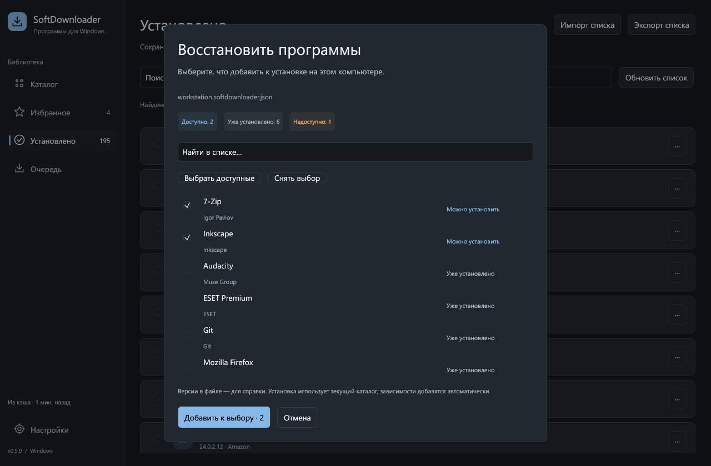 | 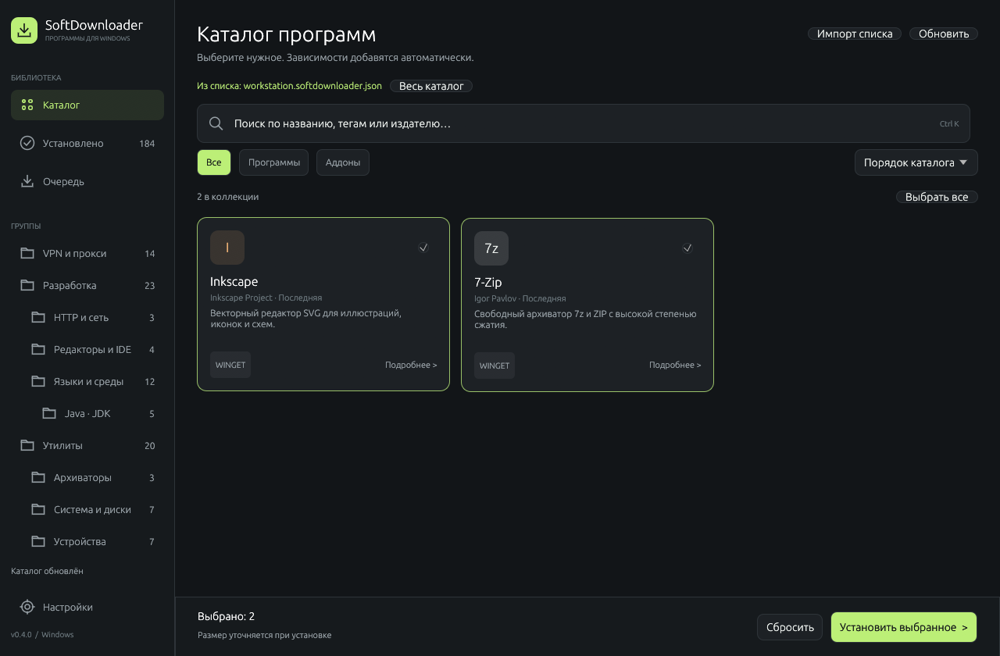 |

## Видео использования

[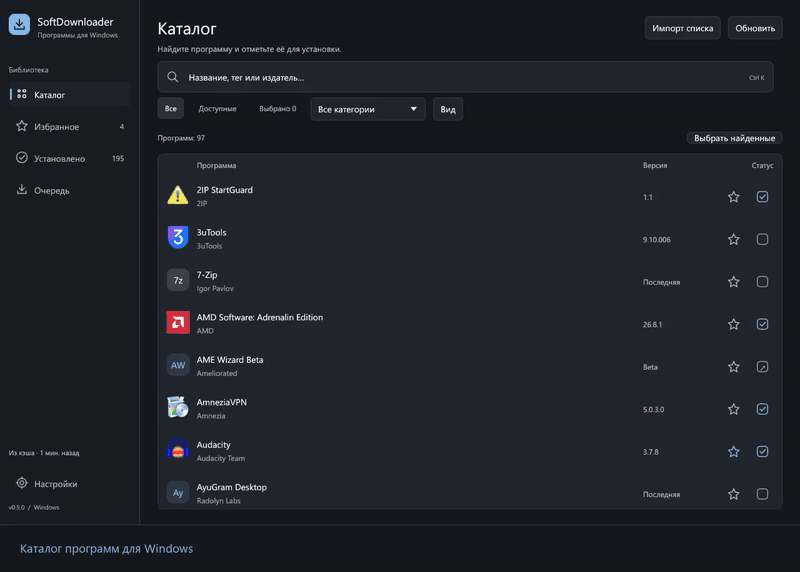](https://github.com/HVHBIGNAME/SoftDownloader/releases/download/v0.5.0/SoftDownloader-0.5.0-demo.mp4)

**[Открыть / скачать полное видео MP4 · 58 секунд](https://github.com/HVHBIGNAME/SoftDownloader/releases/download/v0.5.0/SoftDownloader-0.5.0-demo.mp4)** — запись настоящего окна: список и карточки, избранное, экспорт набора, отмена удаления, импорт примера, очистка и восстановление выбора, подтверждение плана. Звука в записи нет; реальные установщики не запускаются.

## Возможности

| | |
|---|---|
| **Один файл** | `SoftDownloader.exe` со встроенными каталогом, шрифтами и иконками. Сборка оптимизирована по размеру: full LTO, `opt-level=z`, статический CRT. |
| **Автообновление** | GitHub Releases, проверка SHA-256, автоматическая замена EXE и перезапуск. Ожидание очереди и откат при ошибке запуска. |
| **266 пакетов · 26 групп** | Браузеры, общение, разработка, ИИ, VPN, медиа, игры, менеджеры модов, расширения VS Code и системные утилиты. |
| **Одна очередь** | WinGet, Microsoft Store, EXE/MSI, ZIP, portable EXE и расширения VS Code. Тихий режим/мастер, пауза и повтор незавершённых задач. |
| **Учёт установленного** | Реестр Windows, Store, WinGet, VS Code, известные папки и PATH. Удаление по одной программе или списком. |
| **Компактный интерфейс** | Segoe UI, ровные строки и карточки, фиксированные статусы, четыре темы. Виртуализированные списки, короткие переходы и уведомления без сдвига содержимого. |
| **Готовые и свои наборы** | Десять готовых подборок, до 32 именованных наборов, экспорт JSON и отмена удаления. Выбор, режимы и сортировка сохраняются. |
| **Иконки до установки** | Встроенные изображения для всех 266 карточек, без сети. Иконки установленного ПО читаются в фоне; кэш ограничен. [Источники и устройство](docs/icons.md). |
| **Кэш и таймауты** | Каталог сохраняется на час. Явное обновление обходит кэш; успешные ответы сохраняются даже при таймауте других источников. |
| **Проверка файлов** | SHA-256 из каталога/GitHub; для официального сайта без опубликованного хеша — Authenticode средствами Windows. |

<details>
<summary><b>Что есть в каталоге</b></summary>

| Группа | Примеры |
|---|---|
| Общение и браузеры | Discord, Telegram, AyuGram, Thunderbird, Brave, Chrome, Firefox |
| ИИ | Cursor, Trae, Antigravity, Claude Desktop, Claude Code/CLI, Cline, Hermes, Ollama, LM Studio |
| Разработка | VS Code, Visual Studio Community 2026, JetBrains Toolbox, Android Studio, Neovim, Git, Docker, Unity Hub, Godot |
| Командная строка | PowerShell 7, Windows Terminal, GitHub CLI, CMake, Ninja, LLVM, ripgrep, fd, bat, fzf, lazygit, Yazi, FFmpeg |
| Базы данных | DB Browser for SQLite, DBeaver Community, HeidiSQL |
| Расширения VS Code | Python, Pylance, Rust, Go, C/C++, C#, Jupyter, GitLens, Prettier, ESLint, Ruff, Remote SSH, WSL, Continue, Roo Code, Copilot |
| Языки и среды | Python 3.13/3.14, Node.js LTS, Go, Rust, Bun, Deno, Zig, Julia, Visual C++ x64/x86, Temurin JDK 8/11/17/21/25 |
| VPN и сеть | Amnezia, FlClash, Happ, Proton, Mullvad, Windscribe, WireGuard, WARP, Hiddify, Tailscale, Proxifier, TgWsProxy, zapret |
| Медиа и творчество | Spotify, VLC, OBS, Audacity, Blender, GIMP, Inkscape, CapCut, HandBrake, Shotcut, Kdenlive, REAPER, Figma, darktable |
| Игры и устройства | Steam, Epic, GOG, Heroic, Playnite, GeForce NOW, Moonlight, LabyMod, Modrinth, Prism, ATLauncher, CurseForge, Meta Horizon Link |
| Менеджеры модов | WeMod, r2modman, Vortex, Mod Organizer 2 |
| Документы и заметки | Obsidian, Joplin, Anki, LibreOffice, ONLYOFFICE, SumatraPDF, calibre |
| Утилиты | WinRAR, Bandizip, 7-Zip, NanaZip, CrystalDiskInfo/Mark, HWiNFO, CPU-Z, GPU-Z, System Informer, Process Explorer, ShareX, WizTree |

219 пакетов используют WinGet: 218 из `winget`, один из `msstore`. Ещё 10 — прямые загрузки, 32 расширения — Marketplace. У пяти ручных карточек есть ссылка и инструкция: Hermes, AME Wizard Beta, AMD Software, NVIDIA App и 2IP StartGuard.

В 0.7.0 добавлены ещё 26 программ, включая Zotero, Logseq, Notion, PDFgear, Super Productivity, Pomotroid, AutoHotkey, TranslucentTB, WinCompose, WizFile, Process Monitor, TCPView, ZoomIt, foobar2000, PotPlayer, Okular, Kate, draw.io, Sioyek, PeaZip, AnyDesk, VirtualBox, Freeplane, Jellyfin Media Player, KiCad и Stellarium.

В 0.6.0 добавлены LocalSend, KDE Connect, QuickLook, Ditto, Flow Launcher, Auto Dark Mode, CopyQ, Bulk Crap Uninstaller, UniGetUI, PDF24 Creator, NAPS2, File Converter, ScreenToGif, Double Commander, Duplicati и ImageGlass. Идентификаторы и установщики проверены через актуальный источник WinGet.

ESET Premium скачивается через очередь по официальной ссылке, проверяется по подписи Windows и открывает Live Installer. Вход в ESET HOME и активация выполняются в мастере ESET.

Расширения устанавливаются после VS Code и обнаруживаются по своим Marketplace ID. Pylance и Python Debugger добавляют зависимость от расширения Python; GitLens и Git Graph — от Git. Интерпретаторы, игровые профили, моды и языковые модели настраиваются в соответствующих программах.

Полные записи и правила обнаружения: [`catalog/extended.json`](catalog/extended.json). Claude Code и Claude CLI объединены; System Informer — продолжение Process Hacker. TgWsProxy и zapret требуют настройки после распаковки. Подробности установки и удаления — в [документации](docs/catalog.md).

</details>

| Установленные программы | Настройки |
|---|---|
| 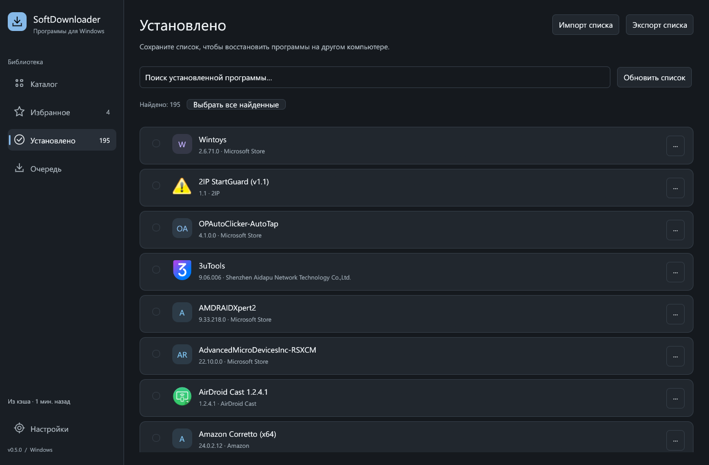 | 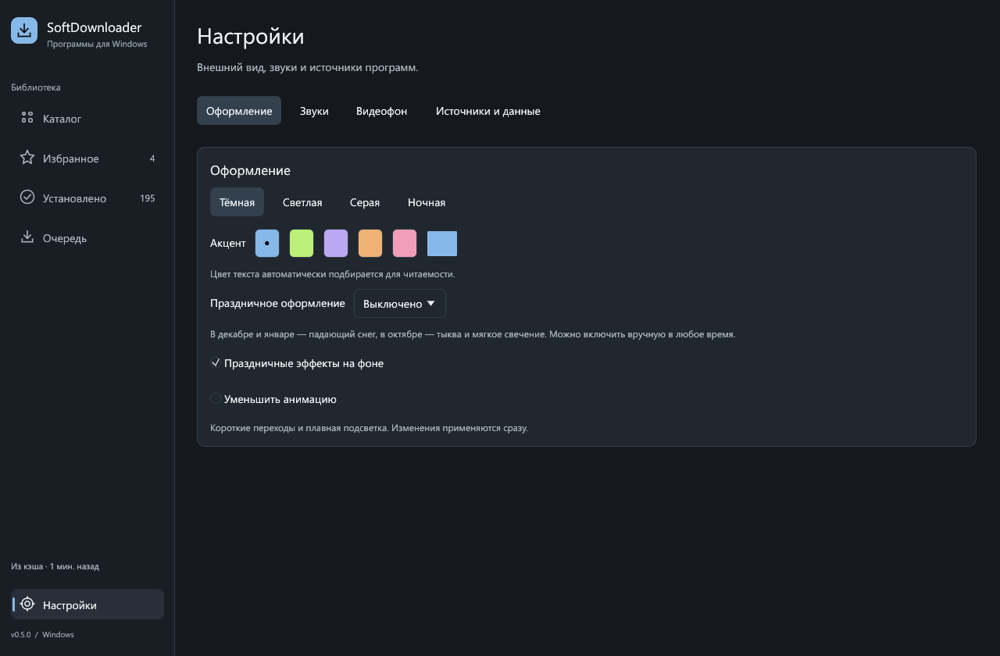 |

## Google Диск — для дополнительного софта

Основной каталог получает программы из WinGet, GitHub и с сайтов разработчиков. **Google Диск предназначен для дополнительных пакетов, которые будут добавлены позже.** Адрес этой коллекции встраивается в приложение; обычному пользователю не нужно подключать свой Диск.

В `0.5.0` канал дополнений подготовлен, публичный каталог ещё не задан. Его адрес задаётся владельцем сборки в [`catalog/channel.json`](catalog/channel.json) или через `SOFTDOWNLOADER_CATALOG_URL` при сборке. Дополнения объединяются с основным каталогом, а стабильные ID сохраняют совместимость экспортированных списков.

Настройка собственного источника находится в свёрнутом разделе настроек для владельца коллекции. **[Подготовка и публикация дополнений](docs/google-drive.md)** · **[Формат каталога](docs/catalog.md)**

## Сборка и проверки

Нужны Rust **1.88+**, MSVC toolchain и Visual Studio Build Tools с компонентом Desktop development with C++.

```powershell
cargo run --release

cargo fmt --all -- --check
cargo clippy --all-targets --all-features --locked -- -D warnings
cargo test --all-targets --all-features --locked
python -m unittest discover -s tools/tests -v

cargo build --release --locked
powershell -ExecutionPolicy Bypass -File tools/package.ps1
python tools/verify_standalone.py --file dist/SoftDownloader.exe
```

Отдельный профиль: `SoftDownloader.exe --data-dir "C:\Temp\SoftDownloader-test"`.
Локальный каталог дополнений: `SoftDownloader.exe --catalog "G:\Мой диск\SoftDownloader\catalog.json"`.

Обычный `cargo build --release` собирает только приложение: `target/release/softdownloader.exe`. Скрипт выпуска копирует его в `dist/SoftDownloader.exe` и записывает контрольную сумму.

Служебный CLI собирается отдельно: `cargo run --features catalog-tools --bin catalog-check -- --resolve`. Флаги `--check-winget` и `--inventory` проверяют ID и обнаружение программ, `--video clip.mp4 --frame frame.png` — нативное декодирование и перемотку видео. CLI предназначен разработчику и в пользовательский релиз не входит. Интеграционные тесты установки/удаления используют изолированные фиктивные пакеты. **[Результаты проверок](docs/verification.md)**.

Снимки гайда, таблицы изменений, погоды и сезонов 0.7.0 воспроизводятся через [`tools/check_experience_ui.py`](tools/check_experience_ui.py). Прежние walkthrough и видео — через [`tools/capture_ui.py`](tools/capture_ui.py), медиа README — через [`tools/prepare_docs_media.py`](tools/prepare_docs_media.py), иконка — через [`tools/make_branding.py`](tools/make_branding.py). Этим инструментам нужен Pillow; видео также использует FFmpeg. GUI-прогоны принудительно устанавливают нулевую громкость в отдельном тестовом профиле. Исходные звуки и графика подготавливаются [`tools/prepare_ui_assets.py`](tools/prepare_ui_assets.py).

### Основные модули

```text
src/program_list.rs    экспорт, валидация и сопоставление списков
src/program_sets.rs    готовые и именованные наборы программ
src/installation.rs    общие и индивидуальные режимы установки
src/catalog_filter.rs  поиск, избранное и просмотр выбора
src/preferences.rs     темы, сезоны, звуки и видеофон
src/backgrounds.rs     каталог и проверка скачиваемых видео
src/weather.rs         поиск городов, прогноз и локальный кэш погоды
src/video/             нативный Windows Media Foundation decoder
src/catalog_cache.rs   кэш, обновление и восстановление метаданных
src/config.rs          встроенный канал дополнений
src/updater.rs         проверка релизов и загрузка обновления приложения
src/updater/           замена EXE, проверка запуска и откат
src/catalog.rs         каталог, категории и зависимости
src/discovery.rs       GitHub Releases и официальные сайты
src/inventory.rs       обнаружение и сопоставление программ
src/engine.rs          фоновые задачи и последовательная очередь
src/ui/                интерфейс и фоновые иконки
src/system/            WinGet, Store, VS Code и Windows API
src/installer/         установщики, подписи, ZIP и portable
src/uninstall/         реестр и способы удаления
tools/catalog.py      подготовка дополнительных пакетов
```

Настройки, история, кэш и журналы хранятся локально; папка открывается из настроек. Исходный код — [MIT](LICENSE); материалы оформления — по [указанным лицензиям](assets/CREDITS.md). Сторонние программы распространяются на условиях своих разработчиков.
