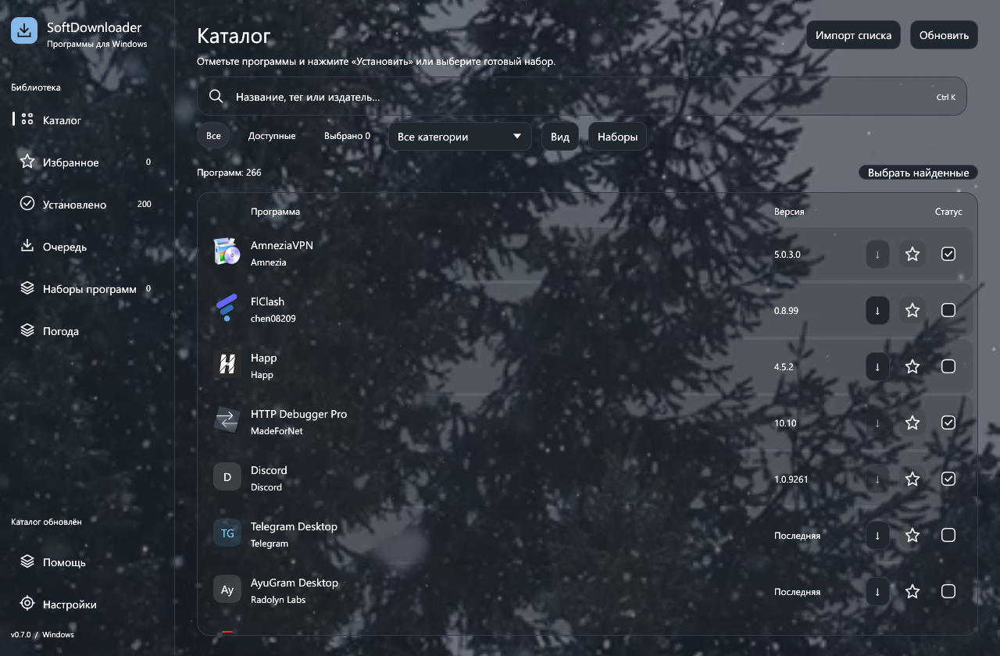
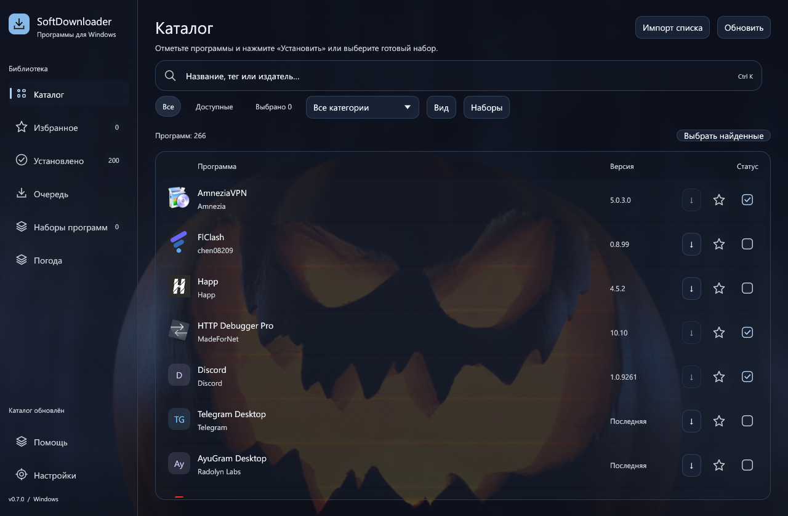
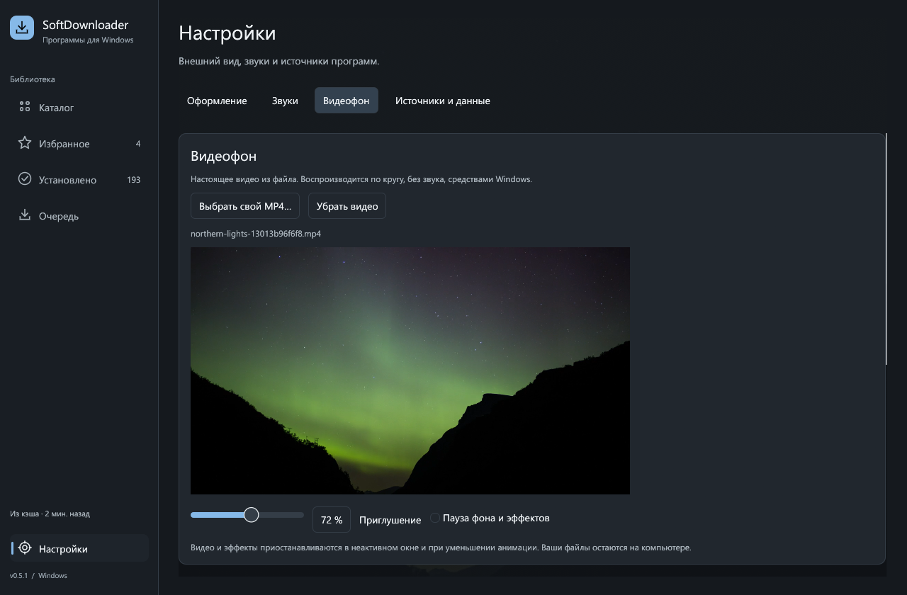
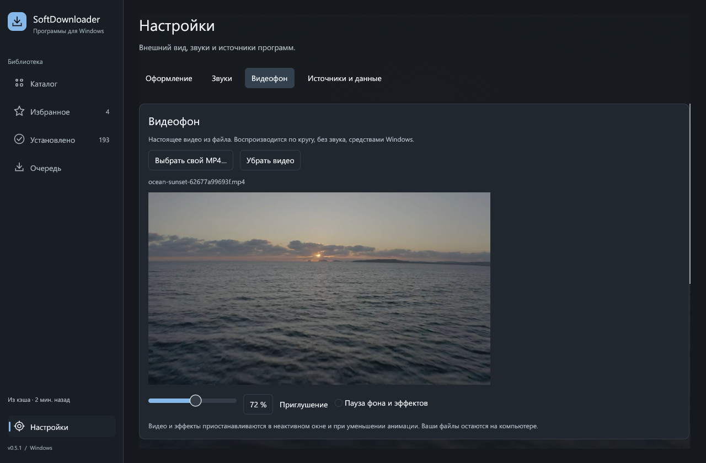

# Оформление, звуки и видеофон

Настройки применяются сразу и сохраняются локально. Кнопка **Настройки** находится внизу левой панели.

## Оформление

Доступны тёмная, светлая, серая и ночная темы. Выберите готовый акцент или задайте свой цвет в палитре. Текст и главное действие автоматически подстраиваются под фон; контраст сохраняется и во время перехода между темами.

В **Праздничном оформлении** можно выбрать:

- **По календарю** — снег в декабре/январе, Хэллоуин в октябре, обычный фон в остальные месяцы. Используется локальная дата Windows.
- **Зима** — несколько слоёв мягких снежинок с разной скоростью, глубиной и движением ветра.
- **Хэллоуин** — фотореалистичная тыква в тёмном лесу, туман, медленное движение кадра и приглушённое свечение.
- **Выключено** — обычное оформление.

Отдельный переключатель **Праздничные эффекты на фоне** отключает графику, сохраняя выбранный режим. **Уменьшить анимацию** применяет темы без перехода и приостанавливает движение фона.

| Зима | Хэллоуин |
|---|---|
|  |  |

## Звуки

Пять оригинальных стереонаборов 44,1 кГц: **Аврора**, **Кино**, **Кристалл**, **Тактильные**, **Орбита**. Короткие нажатия, восходящие интервалы завершения и отдельные мягкие сигналы ошибки. Используются плавная атака, затухание и пространственные задержки.

- Для нового профиля выбран набор **Аврора**, громкость **28%**. Прежние настройки громкости сохраняются. Ползунок управляет уровнем приложения; пиковый уровень ограничен и на максимальном значении.
- **Прослушать** воспроизводит выбранный вариант. Кнопки внизу позволяют отдельно послушать завершение и ошибку.
- **Включить звуковой отклик** полностью отключает или включает сигналы. При нулевой громкости воспроизведения нет.
- **Озвучивать нажатия** позволяет отключить клики, сохранив сигналы результатов.
- Ввод текста не сопровождается сигналами. Частые клики объединяются, чтобы звук не превращался в непрерывную очередь.

Генератор оригинальных звуков и лицензия описаны в [источниках материалов](../assets/CREDITS.md). Старые идентификаторы `glass`, `wood`, `digital` сохранены для совместимости; они выбирают заново созданные наборы. Проверены длительности, стереоформат, отсутствие клиппинга и ограничение громкости. Субъективное звучание можно оценить кнопками прослушивания.

## Видеофон

1. Откройте **Настройки → Видеофон**.
2. Нажмите **Выбрать свой MP4…** либо **Скачать и включить** у готового ролика.
3. Настройте **Приглушение**. Для просмотра исходного ролика раскройте **Предпросмотр исходного видео**.
4. **Пауза фона и эффектов** останавливает движение. **Убрать видео** возвращает обычный фон.

Видео покрывает всё окно: боковую панель, карточки каталога и область выбора. Кадр сохраняет положение при прокрутке и открытии подробностей, масштабируется при изменении размера окна. Панели становятся полупрозрачными, диалоги подтверждения остаются непрозрачными. Контраст текста подстраивается под диапазон яркости видео; при необходимости фактическая яркость фона дополнительно ограничивается.

В приложении есть **11 готовых фонов** из настоящих видео Mixkit. Четыре прежних пейзажа:

| Фон | Длительность | Загрузка |
|---|---|---|
| Снег в хвойном лесу | 10 секунд | 3,9 МиБ |
| Звёзды над Маттерхорном | 4 секунды | 1,6 МиБ |
| Северное сияние | 12 секунд | 3,6 МиБ |
| Закат над морем | 18 секунд | 5,8 МиБ |

Добавлены дождь за стеклом, туман в осеннем лесу, снежный лес, облака над Альпами, солнечный лес, ночная гроза и Хэллоуин с огнём. Между роликами применяется плавный переход. При ручном выборе видео погодный режим выключается, выбранный город сохраняется.

## Погода

Отдельная страница **Погода** доступна из боковой панели и настроек оформления. Она сохраняет основные цветовые темы, подбирая фон по погоде выбранного города. Доступны поиск города, определение по IP, демонстрация эффектов и отключение загрузки видео. [Подробная инструкция](weather.md).

Нажмите **Скачать и включить** у понравившегося пейзажа. Ролик загрузится с проверкой размера и SHA-256 и сразу станет фоном. У каждого есть ссылка на источник и лицензию. Во время загрузки доступна отмена. Загруженные файлы лежат в подпапке `backgrounds` папки данных приложения; повторное включение использует проверенный локальный файл.

Свой файл остаётся на прежнем месте: сохраняется только путь. Если переместить или удалить его, выберите его заново. Список переносимых программ не содержит видео и настройки оформления.

Воспроизведение выполняет **Windows Media Foundation**, без звука и внешнего плеера. MP4/H.264 — наиболее совместимый вариант; диалог также позволяет выбрать M4V, MOV и WMV, доступность кодека проверяется при открытии. Пользовательский файл ограничен 512 МиБ; декодирование уменьшает кадр до 1280×720, сохраняя пропорции. В неактивном/свёрнутом окне и при уменьшении анимации видео ставится на паузу.

| Северное сияние | Закат над морем |
|---|---|
|  |  |
