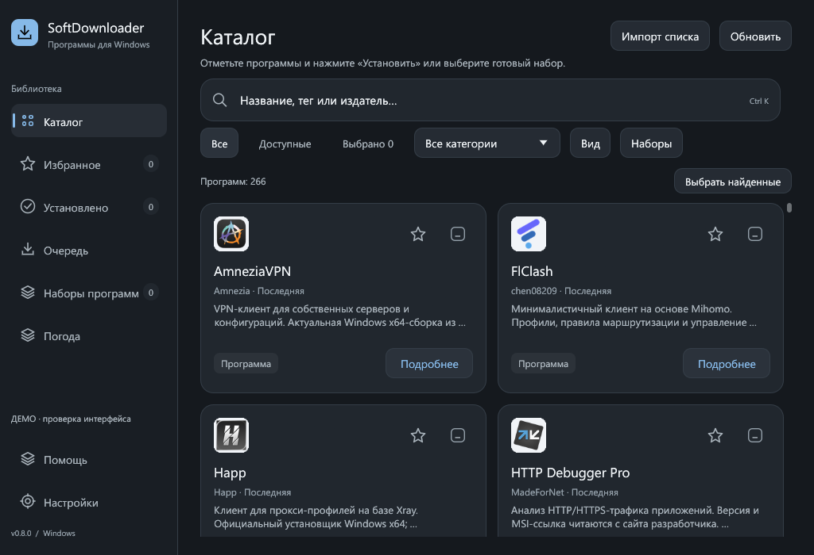
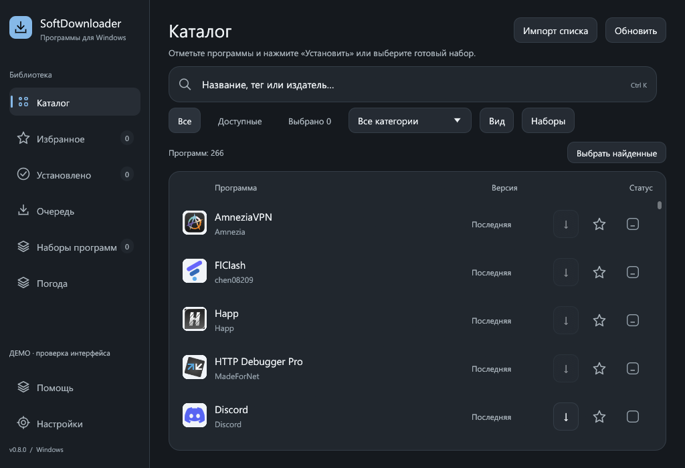

# Иконки программ

Основной каталог имеет иконки для **266 из 266 карточек**, включая ещё не установленные программы. Изображения встроены в EXE: сеть, сторонний плагин и отдельная папка с картинками не нужны.

В каталоге сначала используется иконка установленной программы, если Windows позволяет её прочитать. Пока она загружается или если её нет, показывается встроенное изображение продукта. Та же подборка используется в очереди и для сопоставленных программ на странице «Установлено». Буквенные заглушки остаются только для неизвестных внешних пакетов без подходящей локальной иконки.

**260 карточек** используют изображения продуктов или их семейств, **6** — авторские пиктограммы назначения: Ninja, ripgrep, delta, lazygit, zapret и Shutdown PC Timer. Они не выдаются за официальные логотипы. Источники перечислены в [индексе](../catalog/icons.json), лицензии — в [CREDITS](../assets/CREDITS.md).

Атлас содержит **254 уникальные ячейки**, 1088×1088 RGBA, около 913 КиБ в PNG и 4,52 МиБ распакованных пикселей. Повторяющиеся изображения используют одну ячейку. Атлас загружается один раз; поиск и отрисовка не скачивают и не декодируют каждую иконку заново. Кэш локальных иконок по-прежнему ограничен 512 текстурами.

| Карточки | Список |
|---|---|
|  |  |

Снимки получены офлайн-просмотрщиком с настоящим рендером приложения. В нём не разрешаются сетевые ссылки установщиков, поэтому часть действий недоступна; активирующий ввод блокируется. Размеры, светлая тема и увеличенный масштаб проверены в [визуальном аудите](ui-design.md).

## Подготовка и проверка

Для работы клиента эти инструменты не нужны. Разработчику потребуются Python, Pillow, `resvg-py==0.5.0` для SVG и `pefile==2024.8.26` для чтения значков из EXE; `gh` нужен только для поиска новых исходников.

Повторная сборка атласа по зафиксированным адресам и SHA-256:

```powershell
python tools/prepare_catalog_icons.py --cache "C:\Temp\catalog-icons" --sources catalog/icons.json
```

Папка `C:\Temp` должна существовать. Изменившийся исходник не пройдёт проверку хеша. EXE-источники разбираются только как данные, программы не запускаются. Результат публикуется в `assets/catalog-icons.png` и `catalog/icons.json` после успешной обработки всех источников.

Для новых карточек доступны `--discover` и `--web`; ручные исправления находятся в `catalog/icon-overrides.json`. Автоматически найденные кандидаты нужно просмотреть: значок сайта или библиотеки не всегда совпадает с иконкой продукта. Ошибки поиска сохраняются в `discovery-errors.json`, обработки — в `failed.json` внутри кэша.

Rust-тест проверяет покрытие всего встроенного каталога и границы ячеек. Нативные снимки воспроизводятся так:

```powershell
cargo build --features catalog-tools --bin client-preview --locked
python tools/check_client_ui.py --exe target/debug/client-preview.exe --output docs/assets --temp-root "C:\Temp"
```
