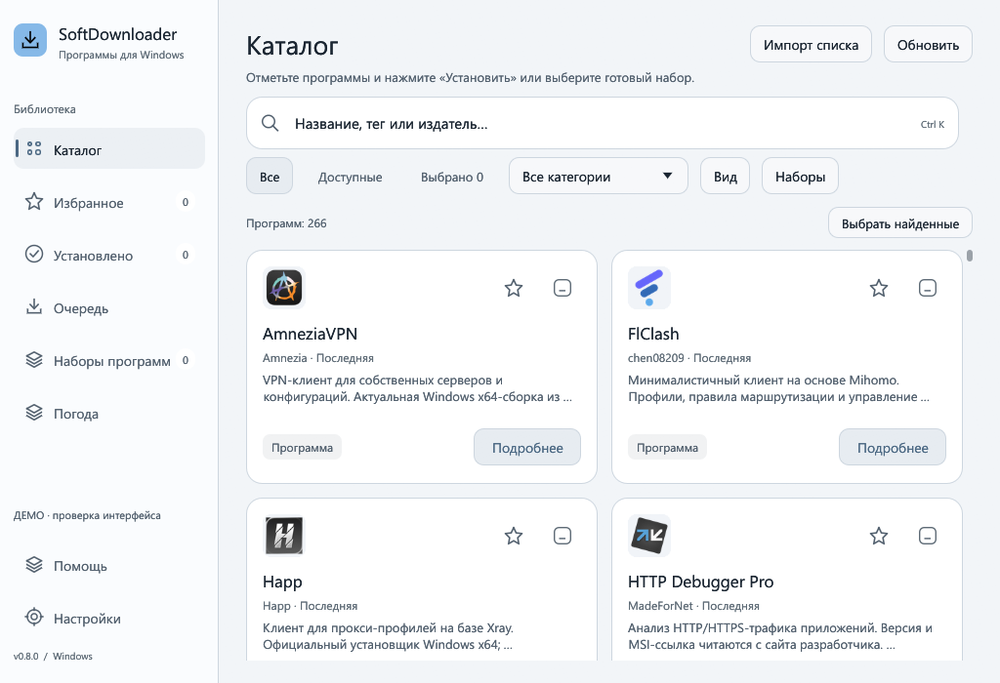
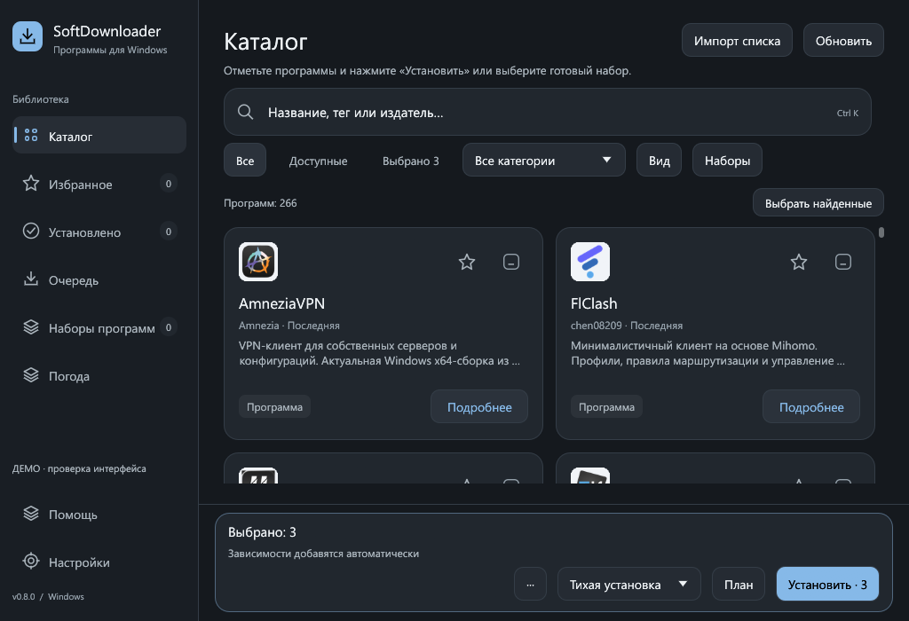
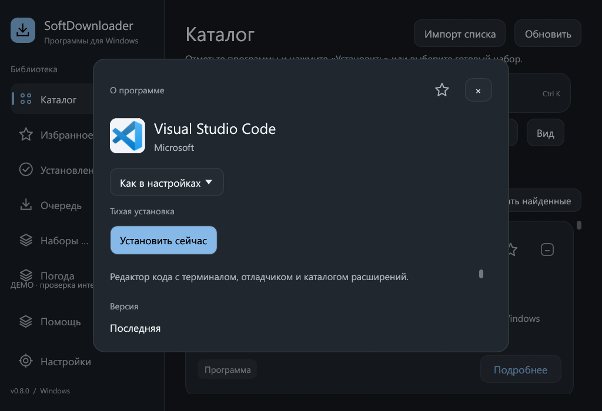

# Визуальный аудит интерфейса

Изменения интерфейса версии 0.8.0. Проверка выполнена по снимкам настоящего окна, а не только по коду.

## Что исправлено

| Проблема | Изменение |
|---|---|
| Вспомогательные кнопки выглядели как тонкие полоски | Минимальная высота 32 точки; обычные действия — 38, главные — 40. Закрытие, копирование и сброс получили полноценную область нажатия. |
| Маленькие подписи в карточках | Основной текст — 15 точек, названия карточек — 17, описания — 13, издатель и версия — 12. Полное обрезанное название доступно при наведении. |
| Статусы очереди растягивались в крупные овалы | Фиксированная высота 26 точек, отдельная строка метаданных; повтор незавершённых задач выделен как главное действие. |
| Нижняя панель теснила режим и кнопку установки | При недостаточной ширине информация и действия занимают две строки. Названия основных действий не разбиваются на строки. |
| При увеличении интерфейса «Погода» пересекалась с «Помощью» | Навигации выделена ограниченная область прокрутки; помощь и настройки остаются отдельно внизу. |
| Подробности вытесняли заголовок и фильтры каталога | В узкой логической области подробности открываются отдельным диалогом. Название, режим и «Установить сейчас» находятся над прокручиваемым описанием. |
| Меню сохранённого набора уходило под нижнюю панель | Меню перенесено вправо в заголовок набора. Поле имени увеличено до высоты соседних кнопок; карточки выровнены по ширине. |
| Непонятно, что ниже есть ещё настройки | Полосы прокрутки видны в покое и имеют зарезервированное место, не перекрывая текст. |
| Погодные кнопки переносились неравномерно | Условия сгруппированы в сетку из трёх или пяти колонок. Высота самой сцены уменьшается в низком окне. |

Размеры указаны в логических точках egui: при увеличении масштаба физическая область нажатия растёт.

## Снимки

| Каталог | Светлая тема |
|---|---|
|  |  |

| Выбор и установка | Подробности при 125% |
|---|---|
|  |  |

[Очередь](assets/client-mixed-narrow.png) · [Настройки](assets/client-settings-narrow.png) · [Наборы](assets/client-sets-narrow.png) · [Панель подробностей](assets/client-details-narrow.png).

## Объём проверки

- 23 сценария: карточки, список, длинные названия, подробности, выбор, подготовка, план, импорт, установленные программы, подтверждение удаления, наборы, погода, гайд, новости, шесть разделов настроек и три результата очереди.
- Размеры клиентской области **1280×840** и **1024×700**. Дополнительно проверены проблемные экраны при **125% масштаба egui**: в минимальном окне это примерно 819×560 логических точек. Настройки масштаба Windows не менялись.
- Светлая тема проверена на каталоге, списке, подробностях, очереди, установке и оформлении. Длинные области дополнительно просмотрены после прокрутки.
- Два регрессионных теста проверяют границы основных кнопок, отсутствие переносов их подписей, разделение навигации и нижних действий, сохранение заголовка каталога и кнопки установки при узких подробностях.
- Проходят **123 Rust-теста**: 114 модульных и 9 интеграционных; CPU-бенчмарк запускается отдельно. Проходят Clippy и форматирование. Данные и результаты в снимках демонстрационные; успешная установка сторонних программ из них не следует.

## Воспроизведение

Нужны Windows, Rust и Python с Pillow. Родительские папки назначения должны существовать.

```powershell
cargo build --features catalog-tools --bin client-preview --locked
python tools/check_client_ui.py --exe target/debug/client-preview.exe --output "C:\Temp\Screenshots" --temp-root "C:\Temp" --scenarios details selected settings mixed sets import --scroll
python tools/check_client_ui.py --exe target/debug/client-preview.exe --output "C:\Temp\Screenshots" --temp-root "C:\Temp" --scenarios details selected --zoom 1.25
python tools/check_client_ui.py --exe target/debug/client-preview.exe --output "C:\Temp\Screenshots" --temp-root "C:\Temp" --scenarios catalog settings --light
```

Просмотрщик принимает прокрутку и блокирует активирующий ввод мышью/клавиатурой, чтобы снимки не запускали установку или удаление. Поведение кнопок проверяется отдельно через egui-тесты с изолированным тестовым пакетом.
