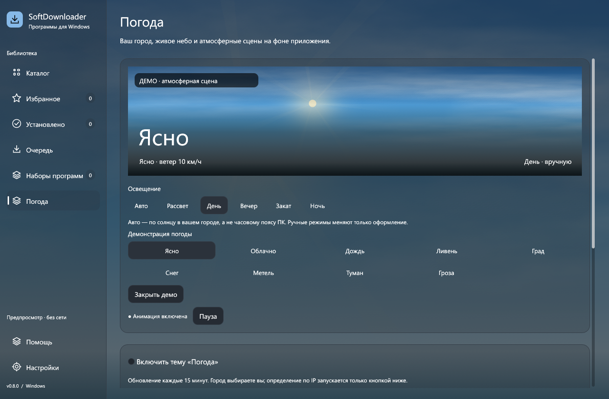
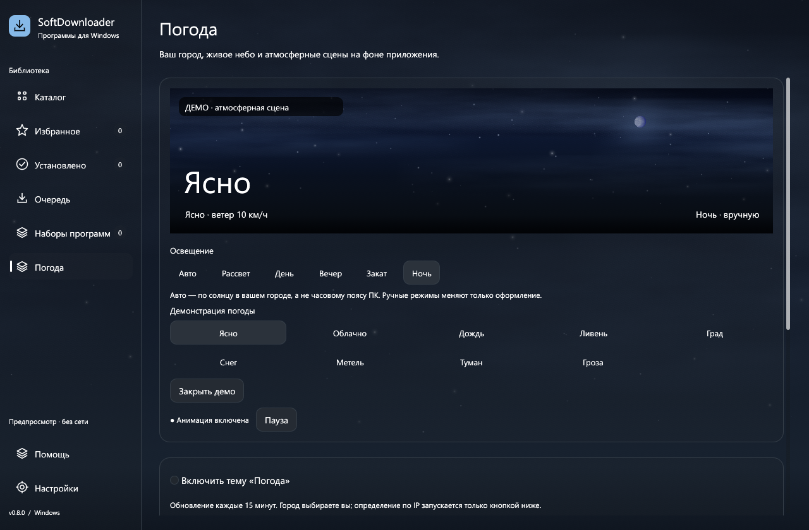

# Погода по городу

1. Откройте **Погода** в боковой панели или **Настройки → Оформление → Погода по городу**.
2. Начните вводить название города. Через небольшую паузу появятся варианты с регионом и страной — выберите нужный.
3. Либо нажмите **Определить по IP** и подтвердите найденный город. Это приблизительное определение; при VPN оно может показывать город VPN-сервера. Автоматического запроса геолокации при старте нет.
4. Переключатель **Включить тему «Погода»** включает фон. Выбор города сохраняется в профиле.

## Данные и отображение

- Данные получает клиент **MET Norway Locationforecast**. Используется ближайший текущий час прогноза, температура, ветер и осадки. Обновление — раз в 15 минут; доступна кнопка **Обновить погоду**.
- Время прогноза показано в UTC; отдельно отображается давность получения. Освещение рассчитывается по текущему UTC и координатам города, независимо от часового пояса ПК и времени последнего ответа сервиса.
- Показаны ясная погода, облака, дождь, ливень, снег, метель, туман и гроза. Метель — визуальный режим снега при ветре от 35 км/ч. Ливень выбирается по коду сильного дождя или интенсивности от 5 мм/ч. При наличии только шестичасового количества осадков отображается средняя интенсивность за этот период.
- Отдельный эффект града доступен в **ДЕМО**. Автоматическое определение града текущим источником не подтверждено; гроза и мокрый снег не выдаются за град.
- При отсутствии сети остаются последние данные с отметкой давности. После шести часов погодный фон по старым данным больше не используется. Ошибка видна в карточке; повторный запрос выполняется через две минуты.
- Ответы для прежнего города или отменённого запроса не заменяют текущую сцену.

## Анимированное небо и день/ночь

Небо рисуется и анимируется в реальном времени: объёмные слои облаков с ветром, дождевые следы, снег разной глубины и движущийся туман. Днём видны солнечный ореол и лучи, ночью — луна и мерцание звёзд. Плотная облачность закрывает светила; грозовое небо темнее обычного. Анимация работает без скачивания MP4.

**Авто / Рассвет / День / Вечер / Закат / Ночь** управляют освещением. Автоматический режим использует высоту и азимут солнца, учитывает сезон, широту и полярный день/ночь. Обычные сутки проходят последовательно через рассвет, день, вечер, закат и ночь; реальные полярные условия сохраняются. Рассвет и закат имеют тёплый горизонт; освещение плавно меняется между состояниями. Ручной режим сохраняется в профиле, помечен «вручную» и не изменяет температуру или осадки. Луна — декоративный элемент сцены, а не астрономический прогноз её положения.

Смена погодного эффекта занимает 2,4 секунды: облачность, ветер, плотность дождя/снега и град смешиваются постепенно. При повторном переключении переход продолжается от текущего вида сцены. Ливень плотнее обычного дождя, град падает и отскакивает, метель усиливает горизонтальное движение снега.

На странице погоды есть крупный живой предпросмотр и быстрые переключатели освещения и эффектов. Кнопки **Ясно / Облачно / Дождь / Ливень / Град / Снег / Метель / Туман / Гроза** включают демонстрацию. Она явно обозначена **ДЕМО** и не меняет данные города. **Вернуть погоду города** или **Закрыть демо** выходит из неё.

**Приглушение** регулирует видимость фона за интерфейсом. Анимация продолжается при потере фокуса (планирование до 30 кадров/с вместо 60 в активном окне). Сворачивание, явная пауза и уменьшение движения её останавливают. На странице показана причина остановки и есть **Включить анимацию**; кнопка включает движение также при ранее установленном уменьшении анимации.

Во время установки, загрузки/проверки каталога и при дорогом CPU-кадре частота планирования также ограничивается 30 кадрами/с, количество частиц плавно уменьшается. После снижения нагрузки детализация возвращается. Геометрия осадков, звёзд и облаков рисуется пакетами с ограниченным количеством элементов.

После трёх секунд без ввода фон переходит на планирование 30 кадров/с, сохраняя детализацию. Движение мыши или ввод возвращают активный бюджет; реакция элементов интерфейса не ждёт очередного фонового кадра.

**Добавить фактуру из видеосцен** накладывает подходящий ролик на небо с учётом дневного/ночного освещения. MP4 скачивается с проверкой размера и SHA-256 и кэшируется в `backgrounds` профиля. Каждый файл — до 10 МБ. Это иллюстрация условий, не трансляция камеры выбранного города. Грозовой ролик содержит молнии; видео можно отключить отдельно.

| День | Ночь |
|---|---|
|  |  |

[Запись движения дождя — GIF](assets/weather-design-rain-day.gif). Эти материалы сняты диагностическим приложением с настоящим кодом страницы и рендера, в офлайн-демонстрации.

[Плавные переходы — MP4, 36 секунд](assets/weather-transitions.mp4). В записи условия ускоренно меняются каждые пять секунд; в обычном автоматическом режиме освещение следует реальному времени города.

Основные цветовые темы сохраняются. Погодный режим временно заменяет обычный фон; выключение возвращает прежний MP4 и сезонные эффекты. Явный выбор нового обычного видео выключает погодный режим, сохраняя выбранный город.

## Хранение и источники

В `settings.json` хранятся выбранный город, координаты, режим `weather.lighting` и настройки эффекта. Старые профили получают `automatic`. Последний ответ — в `weather.json`. IP-адрес не сохраняется. Запрос города отправляется Open-Meteo/GeoNames; координаты выбранного города — MET Norway; кнопка IP — IPWho. Видео скачивается с Mixkit.

[Источники и лицензии](../assets/CREDITS.md). Диагностическая проверка API: `cargo run --features catalog-tools --bin weather-check -- Moscow`.

Проверка движения без установщиков, реального города и сети:

```powershell
cargo build --features catalog-tools --bin weather-preview --locked
python tools/check_weather_motion.py --exe target/debug/weather-preview.exe --output docs/assets --temp-root "C:\Temp"
python tools/record_weather_cycle.py --exe target/debug/weather-preview.exe --output docs/assets --temp-root "C:\Temp"
```

Родительская временная папка должна существовать. Инструмент создаёт и удаляет отдельные профили, захватывает только своё окно и сравнивает кадры. В пользовательский EXE диагностический просмотрщик не входит.
